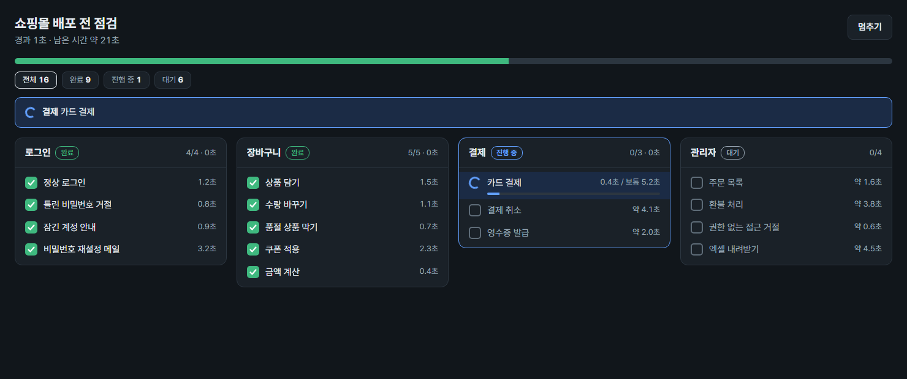
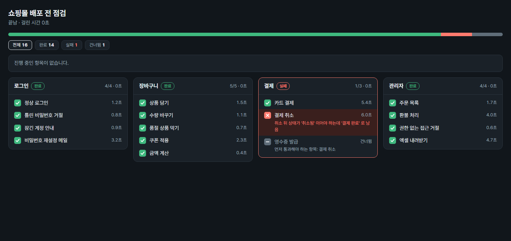

# Test Progress Board

[](https://github.com/ghlee0786/test-progress-board/actions/workflows/test.yml)

**테스트를 조용히 오래 돌리지 않게 — 목록을 먼저 다 보여 주고, 하나씩 체크하면서 진행하는 로컬 진행판과 그것을 프로젝트에 넣어 주는 Claude Code 스킬**



*예시 데이터로 만든 화면입니다.*

> A Claude Code skill that adds a local, live checklist board (React UI + zero-dependency Node server) to any project and runs your tests on it — pytest, Playwright, `dotnet test`, or any list of commands. The UI switches to English automatically (`?lang=en`).

---

## 한눈에 보기

| | |
| --- | --- |
| **먼저 다 보여 줌** | 무엇을 할지 전체 목록을 올린 뒤 시작합니다. |
| **실시간 체크** | 항목마다 대기 → 진행 중 → 완료 · 실패 · 건너뜀 · 중단으로 바뀝니다. |
| **남은 시간** | 지난번 통과한 시간의 중간값으로 예상 시간을 보여 줍니다. |
| **멈추기** | 화면의 버튼으로 멈출 수 있습니다. 남은 항목은 '중단'으로 남습니다. |
| **어디에나** | pytest · Playwright · dotnet test 는 찾아서 연결하고, 나머지는 명령 목록(JSON)으로 돌립니다. |
| **테스트를 막지 않음** | 진행판이 꺼져 있거나 느려도 테스트는 그대로 돌아갑니다. |
| **내 PC 안에서만** | `127.0.0.1` 에만 열고, 다른 사이트에서 온 요청은 거절합니다. 밖으로 보내는 것이 없습니다. |

## 필요한 것

- **Node.js 18 이상** (진행판 서버. 설치할 패키지는 없습니다)
- **Python 3.11 이상** (적용 스크립트와 pytest · dotnet · 명령 목록 어댑터)

## 설치 (Claude Code 스킬)

```bash
git clone https://github.com/ghlee0786/test-progress-board.git
```

`skills/test-progress-board` 폴더를 스킬 폴더로 복사합니다.

```powershell
# Windows (PowerShell)
Copy-Item -Recurse test-progress-board\skills\test-progress-board "$HOME\.claude\skills\"
```
```bash
# macOS · Linux
mkdir -p ~/.claude/skills && cp -r test-progress-board/skills/test-progress-board ~/.claude/skills/
```

그다음 Claude Code 에서 말로 시킵니다.

- "이 프로젝트에 테스트 진행판 넣어줘"
- "테스트 목록 체크하면서 진행해줘"

## 스킬 없이 쓰기

Claude Code 가 없어도 그대로 쓸 수 있습니다.

```bash
python skills/test-progress-board/scripts/apply.py <내 프로젝트>            # tools/test-board/ 에 넣는다
cd <내 프로젝트>
python tools/test-board/adapters/run_pytest.py                              # 알려 준 명령으로 실행
```

`apply.py` 가 하는 일

1. 프로젝트를 훑어 쓰는 테스트 도구를 찾습니다 (`--adapter` 로 직접 고를 수 있음).
2. 진행판과 어댑터를 `tools/test-board/` 에 넣습니다 (`--dest`, `--port` 로 변경, `--dry-run` 으로 미리 보기).
3. 실행 명령을 알려 줍니다. 다시 실행하면 새 판으로 바꾸되 **직접 고친 파일은 덮어쓰지 않습니다.**

| 테스트 도구 | 명령 |
| --- | --- |
| pytest | `python tools/test-board/adapters/run_pytest.py [pytest 인자]` |
| Playwright | `node tools/test-board/adapters/run_playwright.mjs [playwright 인자]` |
| dotnet test | `python tools/test-board/adapters/run_dotnet.py [dotnet test 인자]` |
| 그 밖의 모든 것 | `python tools/test-board/adapters/run_commands.py tools/test-board/checklist.json` |

### 명령 목록 예시

```json
{ "title": "배포 전 점검",
  "groups": [ { "id": "api", "label": "API",
    "items": [ { "name": "단위 테스트", "run": ["npm", "test"], "timeout": 300 },
               { "name": "통합 테스트", "run": "npm run e2e", "needs": ["단위 테스트"] } ] } ] }
```

`needs` 의 항목이 통과하지 못하면 '건너뜀'이 됩니다. **건너뜀은 완료로 세지 않습니다.**



### 코드에서 직접 보내기

```python
from board import Board            # tools/test-board/adapters/board.py
b = Board(); b.ensure()
b.suite("점검", [{"id": "api", "label": "API", "items": ["로그인"]}])
with b.item("api", "로그인"):
    check_login()
b.done("api"); b.finish()
```

Node 클라이언트와 HTTP 이벤트 형식은 [references/events.md](skills/test-progress-board/references/events.md) 에 있습니다.

## 설정

| | |
| --- | --- |
| 포트 | 넣을 때 `--port`, 또는 환경 변수 `TEST_BOARD_PORT` (기본 8790) |
| `TEST_BOARD=0` | 진행판 없이 테스트만 (CI 등) |
| `TEST_BOARD_OPEN=0` | 브라우저를 열지 않음 |
| 화면 언어 | 브라우저 언어를 따름. `?lang=ko` · `?lang=en` |

상태와 예상 시간은 `tools/test-board/.data/` 에 저장됩니다(git 에서 제외). 항목 이름과 설명이 그대로 남으니 비밀번호나 토큰을 넣지 마세요.

## 알아 둘 점

- **dotnet** 은 테스트 하나하나의 시작을 알려 주지 않아 항목이 '대기'에서 바로 '완료'로 바뀝니다. VSTest 방식만 지원합니다.
- **멈추기**: pytest 와 명령 목록은 하던 항목까지 하고 끝내고, Playwright 와 dotnet 은 바로 끊습니다.
- `pytest-xdist` 병렬 실행은 시험해 보지 않았습니다.
- 자세한 동작은 [references/adapters.md](skills/test-progress-board/references/adapters.md).

## 폴더 구조

```text
skills/test-progress-board/
  SKILL.md                  스킬 안내 (Claude 가 읽는 것)
  scripts/apply.py          프로젝트에 넣기
  references/               이벤트 형식 · 어댑터 설명
  assets/board/             프로젝트에 들어가는 것
    server.mjs              서버 (Node 기본 기능만 사용)
    public/                 화면 (React 를 묶어 둔 app.js 포함)
    src/app.jsx, build.mjs  화면 원본 · 다시 묶기 (npm i && npm run build)
    adapters/               pytest · Playwright · dotnet · 명령 목록 · 클라이언트
tests/                      시험 (python -m pytest tests)
```

## 시험

```bash
pip install pytest && python -m pytest tests
```

서버(이벤트 · 재시작 뒤 복원 · 잘못된 입력 · 다른 사이트 요청 거절), 어댑터, 적용 스크립트를 확인합니다. 새 커밋마다 Ubuntu(Python 3.11 · Node 18)와 Windows(Python 3.13 · Node 22)에서 돌립니다. Playwright 와 dotnet 어댑터는 Windows 에서 실제 프로젝트로 확인했고 이 자동 시험에는 들어 있지 않습니다. macOS 에서는 시험해 보지 않았습니다.

## 라이선스

[MIT](LICENSE). 화면에 묶인 React 의 고지는 [THIRD_PARTY_NOTICES.md](THIRD_PARTY_NOTICES.md).
